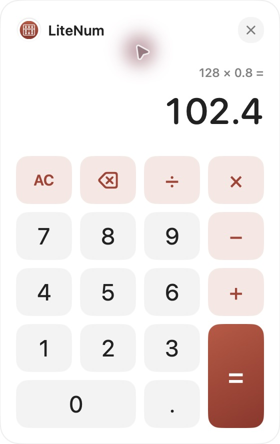

# LiteNum

**轻巧、简洁、随时可算。**

原生 macOS 悬浮计算器。移入悬浮球展开，点击面板后直接用键盘计算，点外部随手收起。本地离线，无需账号。

A small floating calculator for macOS. Hover to open, click the panel to type, and click outside to tuck it away. Native, offline, no account.

[下载 / Download 1.0.1](https://github.com/victor-zhang-2026/LiteNum/releases/download/v1.0.1/LiteNum-1.0.1-macOS-arm64.zip) · [发布说明 / Release notes](https://github.com/victor-zhang-2026/LiteNum/releases/tag/v1.0.1) · [反馈 / Issues](https://github.com/victor-zhang-2026/LiteNum/issues)



## 功能 / Features

- **随时计算**：48pt 悬浮球常驻普通窗口上方，可拖动并记住位置。
- **轻快展开**：移入预览；未点击时移出自动收起。点击面板后保持打开并获得键盘焦点。
- **双重输入**：数字键盘和鼠标按钮均可操作，支持加减乘除、小数、清除与退格。
- **快速收起**：点击外部、右上角叉或按 Esc 收起；右键悬浮球可退出应用。
- **十进制计算**：`128 × 0.8 = 102.4`，`0.1 + 0.2 = 0.3`。按普通计算器的逐步方式运算。
- **本地离线**：无网络、账号、第三方依赖或全局键盘监听，仅保存悬浮球位置。

Hover opens a preview without taking keyboard focus. Click the panel to keep it open and start typing. Move away from an unpinned preview to dismiss it; after clicking the panel, use an outside click, the close button or Esc. The ball stays available. Right-click it to quit.

## 安装 / Install

1. 下载 `LiteNum-1.0.1-macOS-arm64.zip`，解压，将 `LiteNum.app` 拖入「应用程序」。GitHub 的 `Source code` 下载项为源码。
2. 如已有 LiteNum 在运行，先右键悬浮球选择「退出 LiteNum」，再替换并打开新版。
3. 当前包使用 **ad-hoc 本地签名，未经过 Developer ID 签名和 Apple 公证**。核对来源与 Release 中的 `SHA256SUMS`；首次打开可能需要在「系统设置 → 隐私与安全性」中确认。

**Apple Silicon（arm64），部署目标 macOS 13+；实际测试系统 macOS 27.0.1。** 当前界面提示为简体中文，无 Intel 或 Windows 安装包。未设置开机自动启动。

Download the app ZIP, unzip it and move the app to Applications. Quit any existing instance before replacing it. This Apple silicon build is ad-hoc signed and not notarized. The deployment target is macOS 13+; testing was performed on macOS 27.0.1. UI messages are in Simplified Chinese.

## 键盘 / Keyboard

点击展开的面板后即可输入，无需再选择输入框。鼠标点击按钮后仍可继续使用键盘。

| 按键 / Key | 功能 / Action |
| --- | --- |
| `0–9` | 数字 / Digits |
| `.` | 小数点 / Decimal point |
| `+` `-` `*` `/` | 加、减、乘、除 / Arithmetic |
| Enter、数字键盘 Enter、`=` | 等于 / Equals |
| Backspace（Mac 的 delete 退格键） | 退格 / Backspace |
| Forward Delete（Fn+Delete）、数字键盘 Clear | 清除 / AC |
| Esc | 收起 / Dismiss |

键盘输入仅作用于已点击固定、可见且获得焦点的 LiteNum 计算面板。其他应用正常接收自己的按键。

## 计算规则 / Calculation rules

按输入顺序逐步运算，例如 `2 + 3 × 4 = 20`。使用 Foundation Decimal，最多输入 16 位数字，结果保留 16 位有效数字；极大或极小结果用科学计数法显示。无限小数会舍入。

连续运算符替换上一个运算符；重复小数点忽略。结果可继续参与运算，输入新数字可开始新计算。未输入第二操作数时按等号保持现状；重复等号不重复运算。退格仅修改正在输入的数字。除零和超出计算范围会显示错误，可按 AC、退格或输入新数字恢复。

Sequential calculations with 16 significant result digits. Repeating decimals are rounded. Operators can be replaced, duplicate decimal points are ignored, and errors are recoverable. No scientific functions or calculation history.

## 数据与权限 / Data and permissions

仅在本地偏好域 `com.victor.litenum` 保存 `ballX` 和 `ballY`。当前计算在应用运行期间保留，退出后清空。无网络请求、遥测、账号或其他 Lite 应用数据访问。

无需辅助功能权限或全局键盘监听。应用通过本地键盘事件处理计算，通过鼠标事件检测外部点击收起。

## 从源码构建 / Build

需要 macOS、Swift 6.0+ 工具链与兼容 macOS SDK，无第三方依赖。

```sh
git clone https://github.com/victor-zhang-2026/LiteNum.git
cd LiteNum
./scripts/build-app.sh
./scripts/test.sh
open build/LiteNum.app
```

可使用 `LITENUM_MACOS_SDK` 指定 SDK。构建会从统一矢量图元生成 SVG、PNG 和 ICNS，并组装、签名 App。发布包使用 Swift 6.4 和 macOS 27.0 SDK 构建。

`./scripts/test.sh` 可仅使用 Command Line Tools 执行，无需 XCTest。安装完整 Xcode 时也可运行 `swift test`。1.0.0 版曾通过 20 组用例、103 条断言，另有实际窗口、键盘计算与外部点击验证。本次补丁仅做构建和发布检查，覆盖范围见 [发布清单](release/v1.0.1/MANIFEST.md)。

```text
Sources/LiteNum/      SwiftUI 界面、AppKit 窗口和统一矢量 Logo
Sources/LiteNumCore/  Decimal 计算、键盘映射与屏幕布局
Tests/               计算与几何测试
scripts/             构建、图标生成和独立测试入口
Resources/           应用标识与图标
docs/images/         实际截图和品牌资源
release/             发布说明、版本清单和校验值
```

实体双屏、全屏 Spaces 和旧版 macOS 尚未实测。多显示器几何算法测试不等同实体设备验收。

## Lite 系列

[LiteTick](https://github.com/victor-zhang-2026/LiteTick) · [LitePark](https://github.com/victor-zhang-2026/LitePark) · [LiteCal](https://github.com/victor-zhang-2026/LiteCal)

## License

[MIT](LICENSE) — Copyright (c) 2026 Victor Zhang.
